# 4398 游戏管理网站

4398 是一个使用 Spring Boot、Vue、MySQL 和 CheerpJ 开发的游戏管理网站。

登录后，用户可以在 4398 网站中通过字块币（Blockcoin）购买并游玩游戏、整理收藏、管理游玩记录，也可以向 AI 客服询问游戏玩法和网站功能。

管理员则可以维护账户与游戏资料，查看并控制字块币收支，并管理游戏记录。

[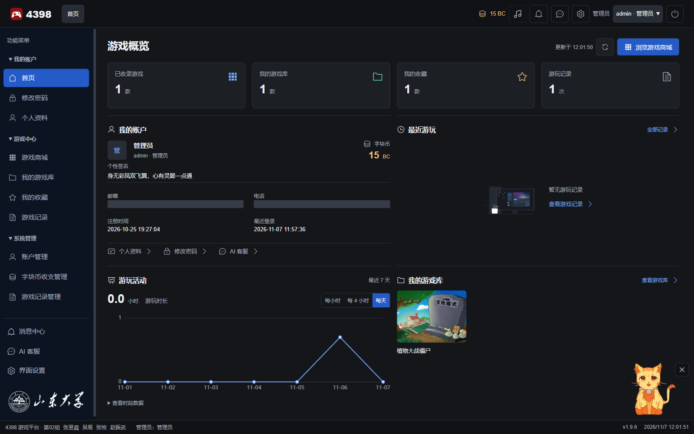](docs/images/dashboard.png)

## 更新日志

### v1.9.6（2026/11/07）

消息中心新增问题反馈，所有账户都可以向管理员提交反馈；管理员可以设置“会修复”“不会修复”或“已解决”，并添加回复。

公告、反馈和回复正文现在支持 Markdown 了，且公告与反馈均支持发布后编辑。

用户现在可以从右上角直接打开反馈表单了。

全站使用了全新定制的鼠标光标。

### v1.8.6（2026/11/06）

cga！新增站内消息中心：现在平台可以发送账户资料、字块币和游戏库变动通知，管理员可以发布全站公告，用户可以查看未读消息并管理已读状态。

现在从右上角切换账户时，最近登录时间和登录次数会同步更新（要是以后打算部署上线，右上角的这个功能肯定会去掉）。

AI 客服 Octorange 现在会结合 4398 网站操作指南回答平台使用的相关问题。

现在用户可以配置登录页背景动画速度了，当前登录背景星点速度是原速度的 4 倍。

### v1.6.4（2026/11/06）

现在管理员可以在账户管理中发放或收回字块币。同时也可以查看每名玩家的游戏库，并撤回游戏。撤回游戏保留原购买流水，不退还金额。

首页的游玩活动折线图支持按每小时、每 4 小时或每天查看统计了。

用户可以隐藏记录列表中的条目，但原记录会继续参与时长统计。

[阅读更早的更新记录](docs/update-history.md)

## 项目概况

本项目采用前后端分离结构：Vue 和 JavaScript 负责页面与交互，Spring Boot 处理业务请求和身份验证，MySQL 保存账户、游戏、字块币流水和游玩记录，CheerpJ 在本项目中用于提供 JVM，以接入游戏大战僵尸（Java 版）及其关卡编辑器。

用户和管理员通过同一入口登录，网站根据账户角色显示功能。首页汇总游戏库、收藏和近期活动，AI 客服 Octorange 与右下角宠物可以回答游戏相关问题。

登录用户可以从顶栏齿轮或侧栏打开界面设置，调整鼠标尾迹、登录背景动画、音乐音量和播放进度。浏览器会保存界面偏好。

## 界面预览

以下截图取自本地 Chrome 中的实际运行页面，首页的邮箱和电话已遮盖。

| 登录页面 | 注册页面 |
| :---: | :---: |
| [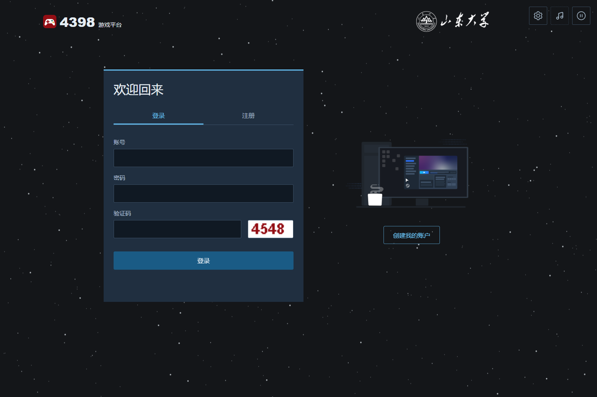](docs/images/login.png) | [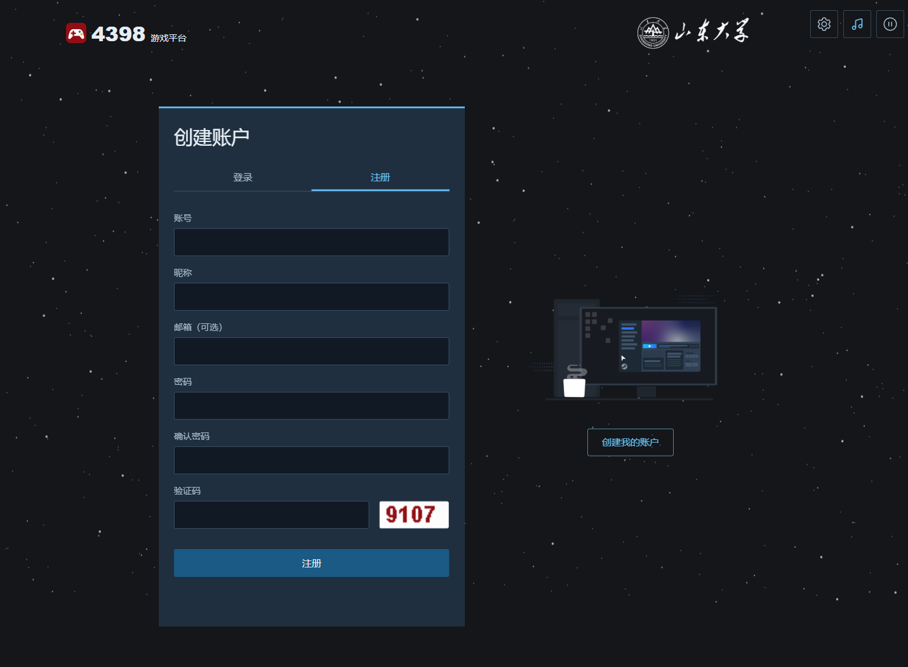](docs/images/register.png) |
| **游戏概览** | **游戏商城** |
|  | [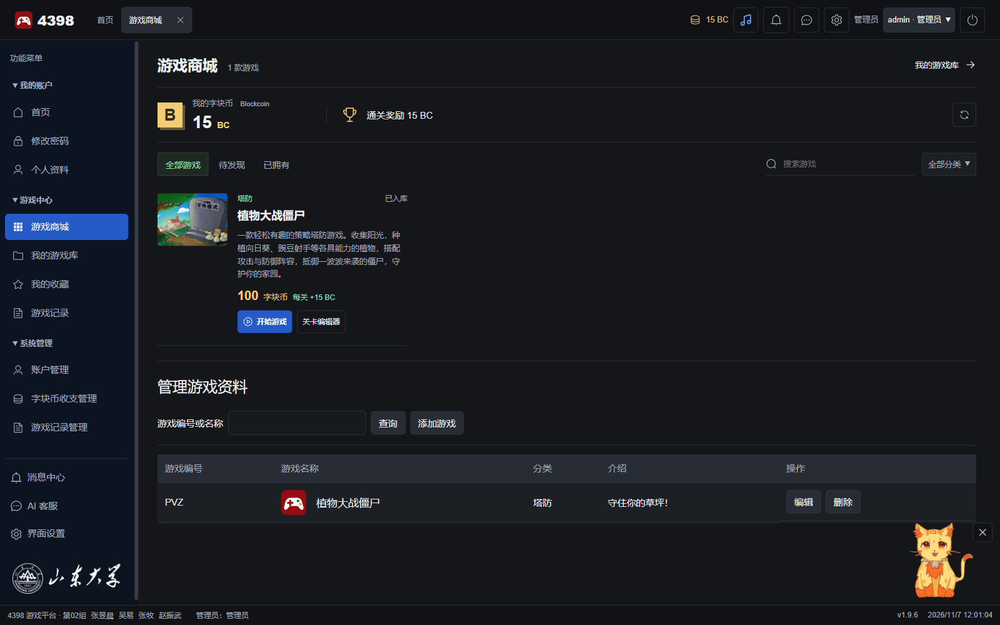](docs/images/store.png) |
| **我的游戏库** | **游戏运行** |
| [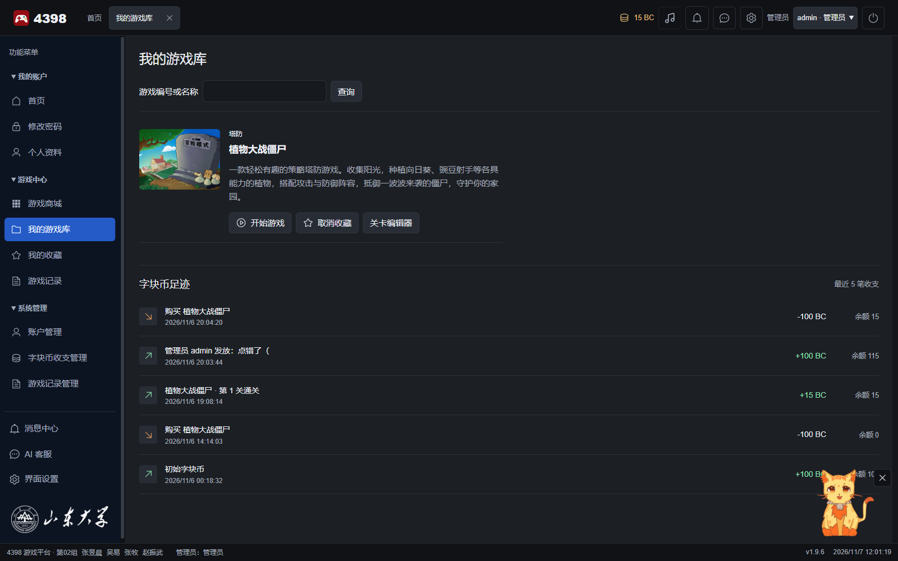](docs/images/library.png) | [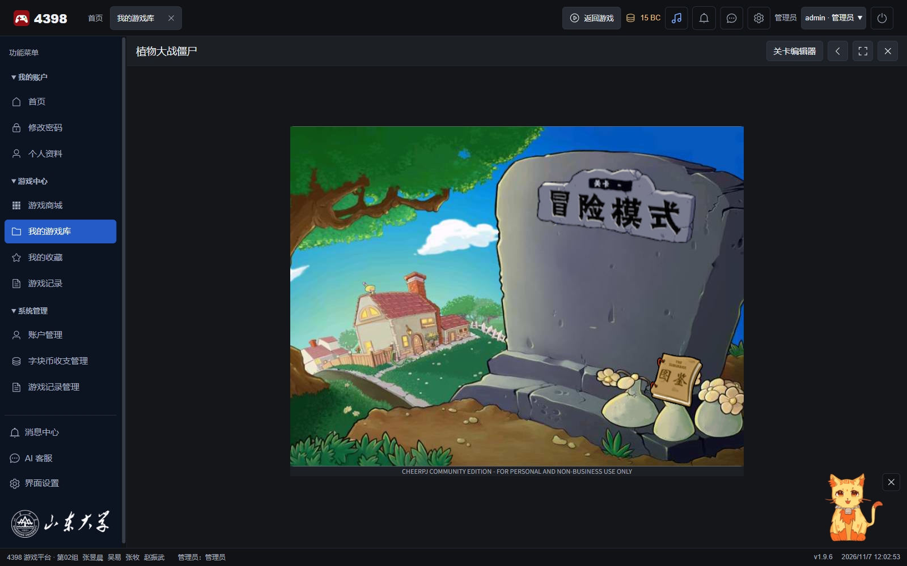](docs/images/game.png) |
| **关卡编辑器** | **消息中心** |
| [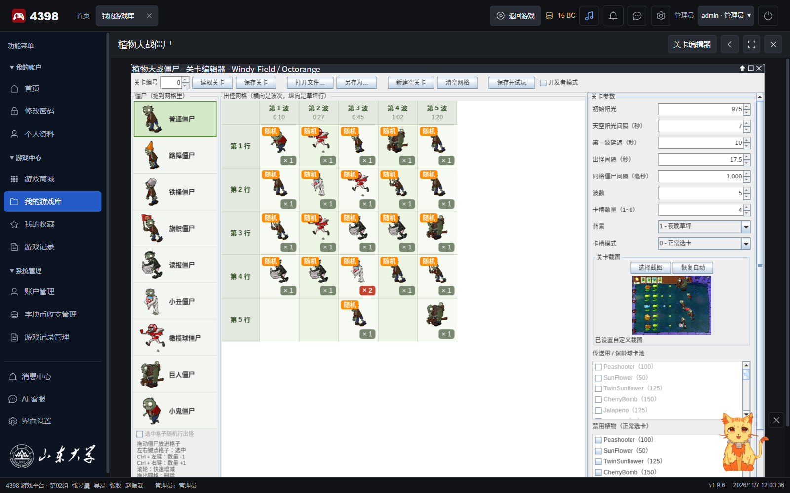](docs/images/editor.png) | [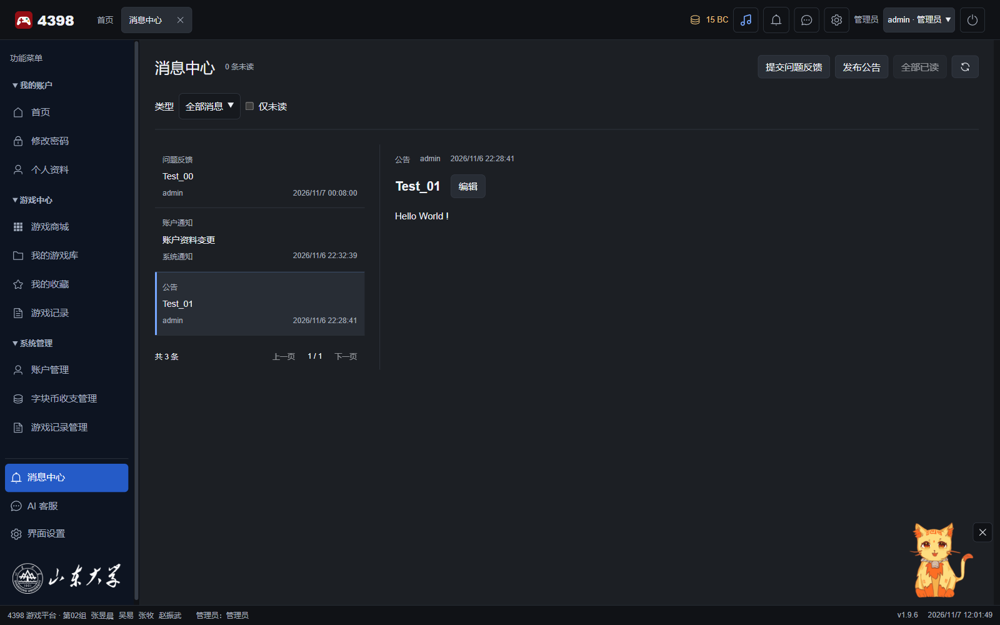](docs/images/messages.png) |
| **问题反馈** | **界面设置** |
| [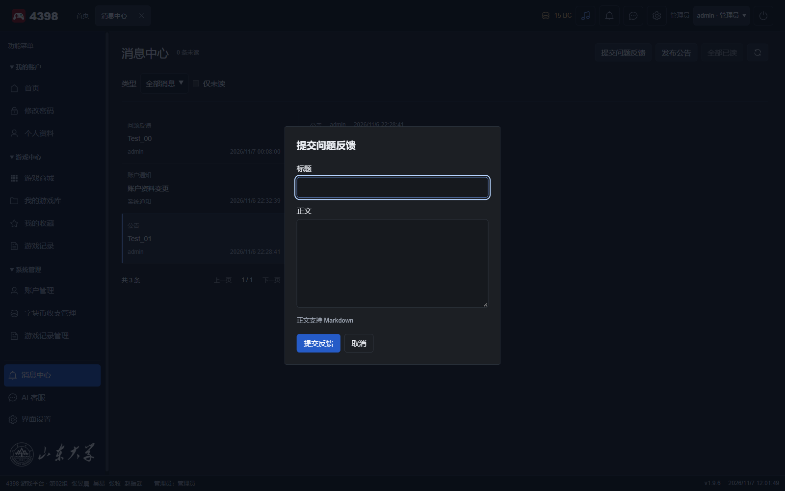](docs/images/feedback.png) | [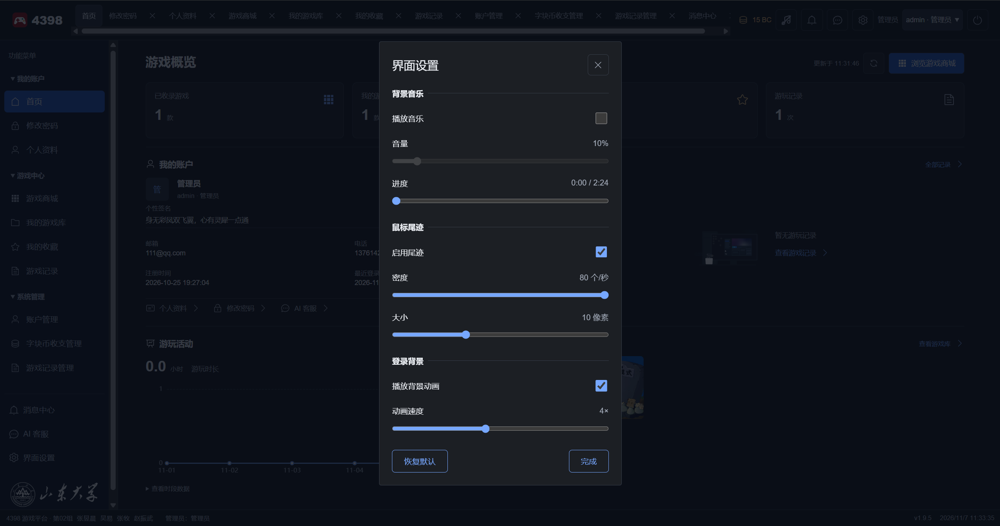](docs/images/settings.png) |
| **登录背景设置** | |
| [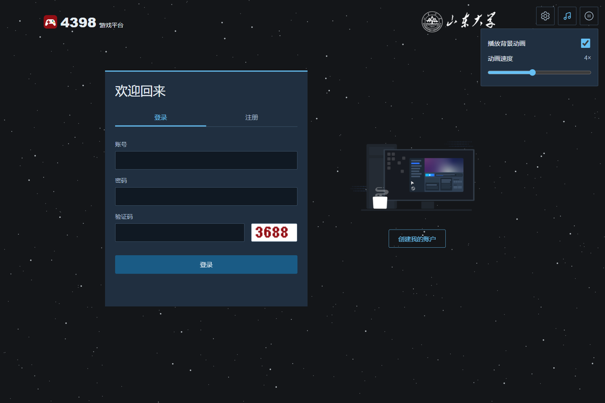](docs/images/login-settings.png) | |

## 其余项目文档

- [项目结构与文件职责](docs/project-structure.md)
- [数据库说明](database/README.md)
- [前端说明](web-vue/README.md)
- [游戏接入说明](docs/game-integration.md)
- [字块币与游戏商城](docs/blockcoin.md)
