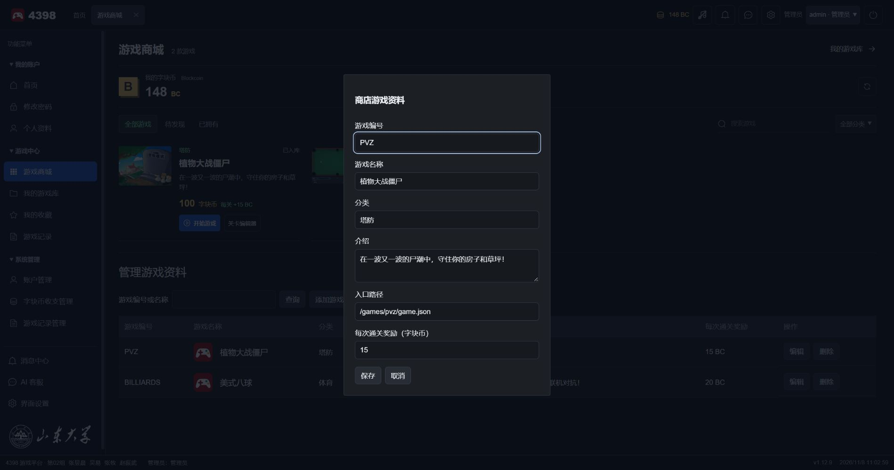
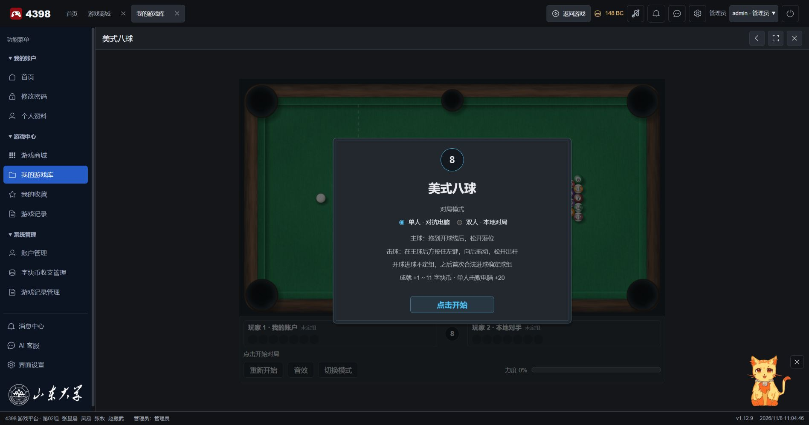
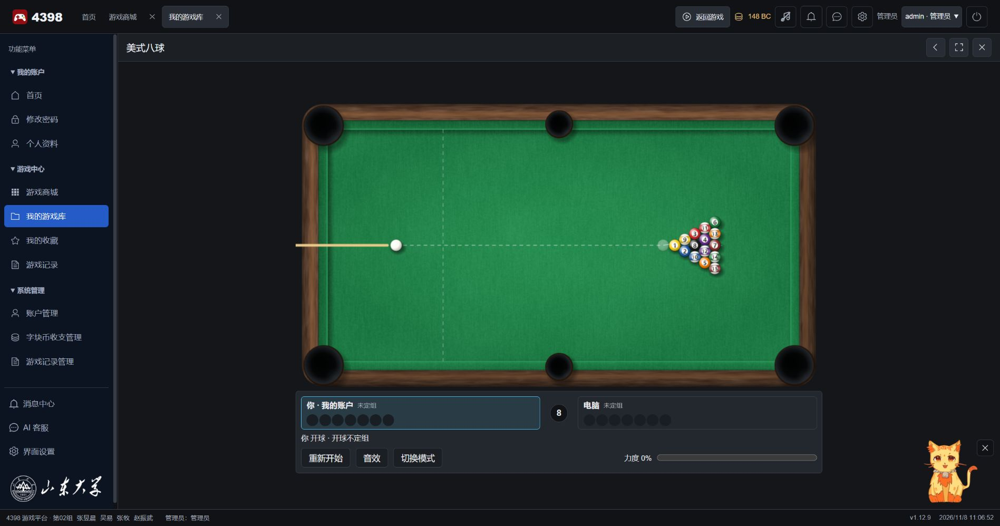
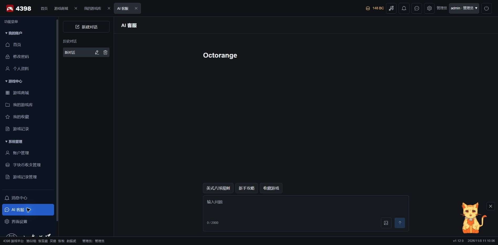

# 4398

4398 是一个使用 Spring Boot、Vue 和 MySQL 搭建的游戏管理网站，支持 Java 游戏与原生网页游戏。

用户登录后，可以使用字块币（Blockcoin）购买和游玩游戏、管理游戏收藏与游玩记录，也可以向 AI 客服咨询游戏玩法和网站功能。

管理员可以管理账户和游戏资料、调整字块币，并查看游戏记录。

## 更新日志

### v1.12.20（2026/11/09）

- 植物大战僵尸通关后，在最后一只敌方僵尸死亡的位置弹出字块币。点击战场后，白光从字块币处扩散并淡入胜利界面。玩家可以选择进入下一关或返回主菜单。
- 植物大战僵尸新增战斗内暂停菜单，可继续游戏或重新开始本关。暂停时间不计入游玩记录。
- 冒险模式和图鉴在网页上显示加载进度，首屏就绪后自动进入。选关页新增双击封面的操作提示。
- 第一关在选卡和战斗时显示四格卡槽。选满后再选卡会提示「卡槽已满」。第二关的四张指定卡显示锁图标，点击时会说明无法更换。

### v1.12.19（2026/11/09）

- 游戏厅优先展示当前对局和最近玩过的游戏。商城、游戏库和收藏统一使用大图游戏卡片。
- 游戏播放器采用专注布局，返回大厅后可以继续当前对局。美式八球更新了模式选择和赛后结算界面，获胜奖励和成就奖励以实际到账为准。
- 桌面侧栏把游戏厅、商城和游戏库放在前面，顶栏集中显示余额、消息和账户。管理员可以从系统管理单独进入游戏资料管理。
- 登录与注册页面增加游戏实景陈列。验证码可在原处刷新，保留已输入的账号。课程演示模式开启时，登录页显示独立的演示入口。

### v1.12.16（2026/11/08）

cga！美式八球新增单人对抗电脑模式（本地双人模式仍然保留），每盘由服务器随机确定先手。电脑会选择进球路线、调整力度并摆放自由球，瞄准和力度带有小幅误差。

增加六项美式八球成就奖励，分别为 1、4、6、8、11、11 字块币，单人获胜奖励为 20 字块币。

美式八球在分出胜负后统一结算本盘成就与获胜奖励，只生成一笔字块币流水和一条到账通知。对局中仍会显示成就解锁提示，但不逐项入账。中途重开或退出的未完成对局不结算，奖励金额保持不变。

修复美式八球获胜后游玩记录仍显示“未通过游戏”的问题。

管理员现在可在游戏资料中设置每次正式通关的字块币奖励，范围为 0–1000。八球成就与获胜奖励不受此字段影响。

管理员在“管理游戏资料”中保存的名称、分类和介绍直接用于商城、游戏库与收藏列表。

新增教师运行包打包入口 `package.cmd`，解压后可通过 `start.cmd` 启动。

更新实拍截图与注释。

### v1.11.3（2026/11/07）

cga！成功利用 Canvas 原生网页接入第二款原创游戏：美式八球。

植物大战僵尸沿用原 Java 运行方式。

### v1.9.8（2026/11/07）

cga！消息中心新增问题反馈，所有账户都可以向管理员提交反馈，管理员可以设置修复状态并回复。

公告、反馈和回复支持 Markdown，公告与反馈也可以在发布后编辑。

用户可以从顶栏直接提交反馈。

平台和游戏页面使用统一的定制鼠标指针样式。

[阅读更早的更新记录](docs/update-history.md)

## 项目概况

本项目采用前后端分离结构。Vue 和 JavaScript 负责页面与交互，Spring Boot 处理业务请求和身份验证，MySQL 保存账户、游戏、字块币流水和游玩记录。植物大战僵尸及关卡编辑器通过 CheerpJ 运行，美式八球使用 Canvas 和 JavaScript 直接运行。

用户和管理员从同一入口登录，平台按账户角色显示功能。首页汇总游戏库、收藏和近期活动，AI 客服 Octorange 与宠物可以回答游戏相关问题。

登录用户可以从顶栏或侧栏打开界面设置，调整鼠标尾迹、登录背景动画和音乐。浏览器会保存这些偏好。

本机启动后，已登录用户可以通过右上角选择框切换数据库中已有的账户。切号功能默认开启，无需另填本地开关；远程与代理访问不开放免密切号。已有配置中的 `app.local-account-switch=false` 或环境变量 `LOCAL_ACCOUNT_SWITCH=false` 仍可关闭此功能。

下载源码不包含数据库或云端密钥。运行完整网站仍需 JDK 21、Node.js、可连接的数据库，以及有效的数据库和 JWT 配置；AI 还需要百炼密钥。首次运行请按[前端说明](web-vue/README.md)安装依赖并构建游戏资源。

## 界面预览

下列截图来自本地浏览器的实际运行页面，点击图片可查看大图。首页中的邮箱和电话已遮盖。

| 登录页面 | 注册页面 |
| :---: | :---: |
|  |  |
| **游戏概览** | **游戏商城** |
|  |  |
| **我的游戏库** | **游戏资料与通关奖励** |
|  |  |
| **美式八球模式选择** | **美式八球单人对局** |
|  |  |
| **植物大战僵尸** | **关卡编辑器** |
|  |  |
| **AI 客服** | **消息中心** |
|  |  |
| **问题反馈** | **界面设置** |
|  |  |
| **登录背景设置** | |
|  | |

## 其余项目文档

- [教师运行包说明](docs/delivery.md)
- [项目结构与文件职责](docs/project-structure.md)
- [数据库说明](database/README.md)
- [前端说明](web-vue/README.md)
- [游戏接入说明](docs/game-integration.md)
- [字块币与游戏商城](docs/blockcoin.md)
