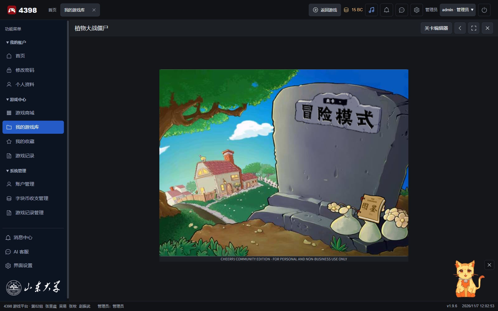
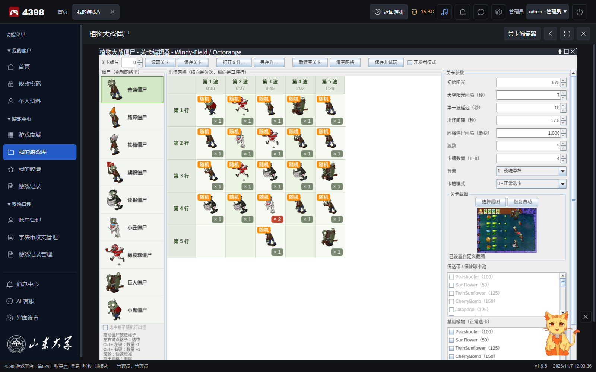

# 植物大战僵尸（Java 版）

本项目使用 Java Swing 编写，包含冒险模式、传送带关卡、坚果保龄球关卡和图形化关卡编辑器。源码展示了 Java 桌面程序、动画、碰撞检测和 JSON 文件读写。

本文件说明独立 Java 工程的运行方式。平台中的浏览器启动方式见[游戏接入说明](../../../docs/game-integration.md)。

**本项目仅能用于学习，禁止商用，严禁抄袭！**

作者：**Windy-Field / Octorange**

## 游戏画面

| 浏览器运行画面 | 关卡编辑器 |
| --- | --- |
|  |  |

## 当前版本

### V1.10

- **选关界面更新**：玩家可以在选关界面直接打开关卡编辑器

## 历史更新

### V1.9

- **关卡与导航**：编辑器支持截图封面选关、双击进入，以及关卡内返回选关
- **植物与僵尸图鉴**：主菜单可查看全部已实现品种的 GIF 动画、数值和能力介绍，支持暂停
- **新增战斗内容**：加入巨人僵尸和小鬼僵尸
- **增加豌豆伤害**：普通、冰豌豆及蘑菇子弹伤害由 20 提升为 25，火焰豌豆由 40 提升为 50
- **重要修复**：修正吞咽与爆炸死亡效果、传送带入场时序和卡片重叠

### V1.8

- 增加铲子卡槽。点击植物可以移除植物，点击空草坪格会自动收回铲子，右键可以取消操作。
- 增加橄榄球僵尸。
- 优化窝瓜索敌，优先攻击近处目标，并压扁落点附近的僵尸。

### V1.7

- 增加双发向日葵。每次生产阳光时会生成两颗阳光。

### V1.6

- 增加火炬树桩、火焰豌豆和子弹转换规则。
- 普通豌豆经过火炬树桩后会变成火焰豌豆；冰豌豆经过火炬树桩后会恢复为普通豌豆。

### V1.5 及更早版本

- 增加 1x、1.5x、2x 三档战斗速度，并使用固定时间步长推进战斗。
- 增加小丑僵尸、传送带关卡、坚果保龄球关卡和图形化关卡编辑器。
- 增加开场演出、阳光收集、卡片冷却和小推车防线等基础机制。

## 快速开始

在 Windows 上安装 JDK 17 或更高版本并保留完整素材后，可以在独立工程根目录运行以下命令：

```bat
run.bat            :: 从第 1 关开始
run.bat 3          :: 从第 4 关开始，参数 0~5 对应第 1~6 关
run.bat test       :: 运行自检
run.bat editor     :: 打开关卡编辑器并载入第 1 关
run.bat editor 3   :: 打开关卡编辑器并载入第 4 关
```

玩家点击“冒险模式”后可以进入选关页。命令行参数可指定默认关卡，编辑器也可以直接载入指定关卡试玩。

游戏入口是 `src/main/java/pvz/Main.java`，编辑器入口是 `src/main/java/pvz/EditorMain.java`。

## 素材目录

```text
assets/
├── Cards/       植物卡片
├── Map/         关卡背景
├── Plants/      植物动画
├── Screen/      菜单和界面图片
├── Zombies/     僵尸动画
├── bullets/     子弹图片
├── new_assets/  新增素材、重复素材和待删除素材
└── levels/      关卡文件 level_0.json ~ level_5.json
```

素材缺失或损坏时，请运行 `run.bat test`。自检程序会检查素材、资料表、动画和关卡文件是否能够正常使用。

## 自检程序

`run.bat test` 会运行 `SelfCheckTest`，检查游戏素材、关卡、主要行为和编辑器读写。检查通过后，程序会输出 `PASS` 并保存测试画面。

## 关卡编辑器

玩家可以从选关页打开关卡编辑器，编辑当前选中的关卡。编辑器会保留未保存内容；玩家关闭编辑器后可以继续选关。


编辑器网格以列表示波次，以行表示草坪位置。每个格子记录该波次该行出现的僵尸和数量。

| 操作 | 作用 |
| --- | --- |
| 将僵尸拖入格子 | 在格子中添加僵尸 |
| 点击格子 | 选中格子 |
| Ctrl + 左键 / Ctrl + 右键 | 减少 / 增加僵尸数量 |
| 滚轮 | 快速调整僵尸数量 |
| 将格子拖到其他格子 | 移动内容；目标格有内容时会交换 |
| 将格子拖出网格或按 Delete | 删除格子中的僵尸 |
| 按 R 或勾选“随机行出怪” | 让这一波的僵尸随机选择行 |

编辑器支持设置阳光、出怪节奏、卡槽和卡池，也可以保存封面并试玩关卡。

## 游戏操作

| 操作 | 作用 |
| --- | --- |
| 点击植物卡片，再点击草坪 | 种植植物 |
| 点击铲子，再点击植物 | 移除植物 |
| 点击空草坪格 | 收回铲子 |
| 鼠标右键 | 取消手中的卡片或铲子 |
| 点击右上角速度按钮 | 切换 1x、1.5x、2x 战斗速度 |

## 项目结构

源码放在 `src/`，素材放在 `assets/`，说明放在 `docs/`，运行和打包工具放在 `scripts/`。

`build/` 保存编译结果和自检截图，`target/` 是 Maven 生成的目录，`dist/` 保存发行包。

```text
src/main/java/pvz/
├── Main.java                     游戏入口
├── EditorMain.java               关卡编辑器入口
├── plant/                        植物资料、卡片和行为
│   ├── BulletTransformation.java 子弹转换资料
│   ├── Card.java                 卡片对象
│   ├── Cards.java                卡槽卡片生成
│   ├── CloseAttackActions.java   近战与保龄球植物行为
│   ├── InstantPlantActions.java  一次性植物行为
│   ├── Plant.java                植物对象
│   ├── PlantActionType.java      植物行为类别
│   ├── PlantActions.java         植物行为调度与坚果换图
│   ├── PlantCatalog.java         植物资料表
│   ├── PlantDefinition.java      单种植物资料
│   ├── ShooterActions.java       射手植物行为
│   └── SunProducerActions.java   产阳光植物行为
├── zombie/                       僵尸资料、出场和效果
│   ├── Zombie.java               僵尸对象
│   ├── ZombieActions.java        普通动作、巨人砸击与投掷、小鬼飞行
│   ├── ZombieCatalog.java        僵尸资料表
│   ├── ZombieDefinition.java     单种僵尸资料
│   ├── ZombieEffects.java        僵尸死亡和特殊效果
│   └── ZombieSpawn.java          僵尸出场记录
├── game/                         游戏流程和战斗系统
│   ├── Almanac.java              图鉴浏览、动画和分页
│   ├── AlmanacDescriptions.java  按内部名称查询的中文介绍
│   ├── LevelSelection.java       选关布局、翻页与输入
│   ├── LevelPreview.java         实际关卡资料生成的封面
│   ├── CombatSystem.java         战斗对象更新
│   ├── Game.java                 游戏主流程与输入处理
│   ├── GameRenderer.java         游戏画面绘制
│   ├── GameScreen.java           游戏画面状态
│   ├── GameState.java            当前游戏数据
│   └── LevelSystem.java          关卡出怪和通关流程
├── level/                        关卡数据和 JSON 读写
│   ├── Level.java                关卡数据
│   ├── LevelJson.java            关卡 JSON 格式约定
│   ├── LevelLoader.java          读取关卡文件和发现编号
│   └── LevelScreenshot.java      截图导入和读取
├── world/                        素材、坐标和公共对象
│   ├── Assets.java               图片与动画加载
│   ├── Bullet.java               子弹对象
│   ├── Car.java                  小推车对象
│   ├── Layout.java               坐标、时间、血量、伤害和界面常量
│   ├── Sprite.java               游戏对象基类
│   └── Sun.java                  阳光对象
├── tools/
│   ├── AssetToolkit.java         图片处理工具
│   └── TextDrawing.java          选关和图鉴共用文字定位
└── editor/                       关卡编辑器
    ├── CheckListPanel.java       植物选择列表
    ├── EditorDragController.java 拖放控制接口
    ├── EditorGrid.java           出怪网格
    ├── EditorIcons.java          编辑器图标
    ├── EditorPalette.java        僵尸选择面板
    ├── LevelDesign.java          关卡数据和文件读写
    └── LevelEditor.java          编辑器主窗口

src/test/java/pvz/
├── JavaStyleTest.java            Java 基础代码风格检查
├── GameInterfaceTest.java        阳光原样显示与选关流程检查
├── DeveloperModeTest.java        开发者模式画面检查
├── LevelScreenshotTest.java      截图与关卡 JSON 保存读取检查
├── AlmanacTest.java              图鉴资料、草坪与动画检查
├── CombatTest.java               血量、子弹、爆炸和僵尸特殊动作检查
├── ConveyorRegressionTest.java   传送带与保龄球入场及队列检查
└── SelfCheckTest.java            项目自检程序
```

源码按植物、僵尸、游戏、关卡和编辑器等职责拆分。主要实现约定如下：

- `PlantCatalog` 和 `ZombieCatalog` 保存植物、僵尸的固定资料。品种差异应优先写入资料表，不要在多个类中重复判断名称。
- `Layout` 保存坐标、时间、血量、伤害和界面布局常量；`LevelJson` 保存关卡 JSON 的字段约定。
- `PlantActions` 处理植物行为，`ZombieActions` 统一处理僵尸行为，`CombatSystem` 安排战斗更新顺序并处理子弹、阳光、小推车和特效，`LevelSystem` 处理关卡时间表。
- 新增品种时优先复用已有资料和行为；少量特殊情况写成所属行为类中的具名方法，形成明确且可复用的一类职责后才考虑独立文件。
- 自检按职责组织，战斗数值、爆炸死亡和巨人、小鬼场景集中在 `CombatTest`，不为单个品种新增自检文件；通用检查仍由 `SelfCheckTest` 调用。
- 编辑器通过 Gson 的 `JsonObject` 和 `JsonArray` 保存关卡，不自行拼接引号或逗号；保存时统一使用缩进格式，字段含义与旧关卡兼容。

## 新增植物示例

新增植物时，开发者应准备素材、登记植物资料和动画，并复用已有行为。新增内容也需要通过自检。

### 必做步骤

开发者需要准备素材、登记植物资料和动画，并运行自检。

### 可选步骤

开发者可以根据植物能力设置睡眠动画、绘制位置或攻击动作。

### 植物行为类别

| 类别 | 行为处理器 | 说明 |
| --- | --- | --- |
| `SUN_PRODUCER` | `SunProducerActions` | 产生阳光 |
| `SHOOTER` | `ShooterActions` | 向同一行的僵尸发射子弹 |
| `INSTANT` | `InstantPlantActions` | 播放一次动画后立即生效 |
| `CLOSE_ATTACK` | `CloseAttackActions` | 僵尸进入近距离后发动攻击 |
| `WALL_NUT` | `PlantActions.updateWallNut` | 根据血量切换裂纹动画 |

## 新增僵尸

新增僵尸时，开发者需要登记动画和僵尸资料，并复用已有的行为处理。新增行为应加入对应自检。

## 制作免安装包

开发者可以在独立工程根目录运行以下命令，为未安装 Java 的电脑制作运行包：

```powershell
.\package.ps1
```

脚本会编译游戏、生成 `game.jar`，再通过 `jlink` 制作精简运行时，输出到 `dist/MyPVZ`。玩家解压后双击 `play-game.bat` 即可离线运行。

## 技术说明

- 游戏使用 Java Swing 绘制，动画由 GIF 逐帧播放。
- 关卡以 JSON 保存，并由 Gson 解析。
- 游戏使用矩形碰撞检测和固定时间步长推进战斗。

## 版权与许可

项目源代码采用 [CC BY-NC 4.0](https://creativecommons.org/licenses/by-nc/4.0/) 许可协议，详见 [LICENSE](LICENSE)。

你可以学习、修改和分享源代码，但必须保留作者署名，且不得用于商业用途。

作者：**Windy-Field / Octorange**（3519936734@qq.com）

许可协议只适用于源代码，不适用于图片、动画和音频等游戏素材。素材版权归原始权利人所有，请勿将素材用于商业用途。
